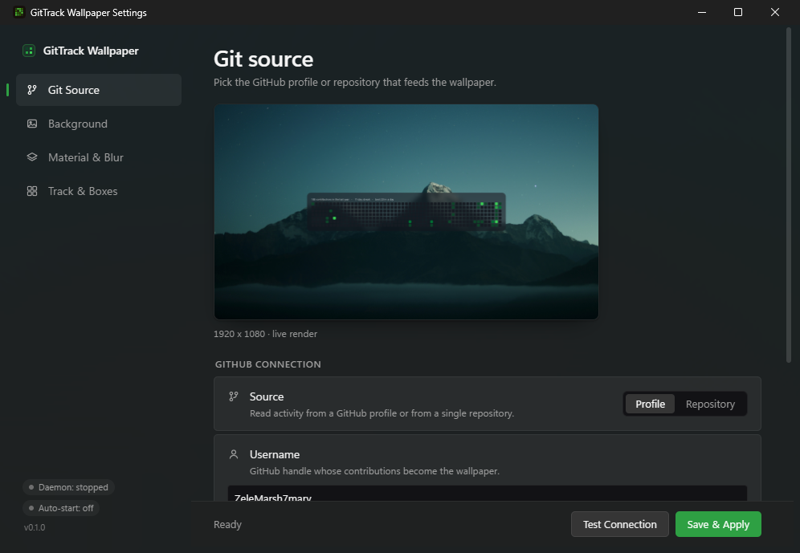

# GitTrack Wallpaper

Your GitHub contribution heatmap, painted onto the Windows desktop wallpaper.
Built as a Cargo workspace with two binaries: a windowless tray daemon that
composites the wallpaper on the CPU, and a throw-away settings window that only
exists while you have it open.



| Binary | Role |
|---|---|
| `git-track-wallpaper.exe` | daemon: fetch, composite, write the wallpaper. No GUI toolkit, no WebView, no async runtime. |
| `git-track-wallpaper-settings.exe` | settings window: Tauri v2 + WebView2 + React. Spawned on demand, dies completely when the window closes. |

Every pixel and every GitHub request goes through `crates/core`, shared by both,
so the preview can never drift from the wallpaper.

## Budgets that are actually held

| Budget | Value | How it is met |
|---|---|---|
| Idle RAM | < 10 MB (daemon) | the daemon links no GUI: `tray-icon` + Win32 only, with `SetProcessWorkingSetSize` after every render |
| Idle GPU | 0% | the wallpaper is written to a PNG and applied with `SystemParametersInfoW(SPI_SETDESKWALLPAPER)`; no window or overlay |
| Settings cost | exits with the window | the WebView2 host is a separate process; closing the window returns all of it to Windows |
| Boot | does not fight login | the first fetch is delayed 12 s; the last wallpaper is already cached natively by Windows |
| Installer | no UAC | Inno Setup `PrivilegesRequired=lowest` into `%LOCALAPPDATA%\Programs\GitTrackWallpaper`, autostart under HKCU |
| Token | never plaintext | Windows DPAPI (`CryptProtectData`) with app entropy, base64 inside `config.toml` |

## Requirements

- Windows 10 or 11 (Mica needs Windows 11 22H2+; Windows 10 gets a flat dark window)
- Rust 1.88+ with the MSVC toolchain, plus the Visual Studio C++ build tools
- Node.js 20+ to build the settings frontend
- Inno Setup 6 to build the installer
- WebView2 runtime (preinstalled on Windows 11)

## Build and run

The settings crate embeds `crates/settings-ui/ui/dist` at compile time, so the
frontend is built first:

```powershell
Set-Location crates\settings-ui\ui
& "C:\Program Files\nodejs\npm.cmd" install
& "C:\Program Files\nodejs\npm.cmd" run build      # -> ui\dist

Set-Location ..\..\..
cargo build --release                              # target\release\git-track-wallpaper.exe
                                                   # target\release\git-track-wallpaper-settings.exe
cargo test                                         # 9 tests, including the headless compositor
cargo run --release -- --render-once out.png       # render one wallpaper without touching the desktop
cargo run --release --                             # daemon + tray icon
cargo run --release -p git-track-wallpaper-settings  # settings window
cargo run --release -- --apply-once                # one fetch + render + set-wallpaper cycle
```

`git-track-wallpaper.exe --settings` still works: it forwards to
`git-track-wallpaper-settings.exe` next to it.

Installer:

```powershell
iscc installer\setup.iss   # output: dist\GitTrack-Wallpaper-0.1.0-setup.exe
```

Regenerate the daemon icon with
`powershell -NoProfile -ExecutionPolicy Bypass -File assets\make-icon.ps1`
(16/32/48/256 px, no imaging library), and the settings-window PNGs with
`powershell -NoProfile -ExecutionPolicy Bypass -File crates\settings-ui\icons\make-icons.ps1`.

## Files and locations

| Path | Contents |
|---|---|
| `%APPDATA%\GitTrackWallpaper\config.toml` | every setting; the token only as a DPAPI blob |
| `%LOCALAPPDATA%\GitTrackWallpaper\cache.json` | per-day cache (`version`, `fetched_at`, `tz`, `days`), written atomically |
| `%LOCALAPPDATA%\GitTrackWallpaper\current_wallpaper.png` | the most recent rendered wallpaper |
| `%LOCALAPPDATA%\GitTrackWallpaper\daemon.log` | one-line log (failed fetch, render, PNG size) |

## Settings window

Tauri v2 shell, 980 x 650 (minimum 820 x 540), centered, dark native caption.
The frontend is React 18 + TypeScript (strict) + Vite with hand-written CSS — no
component library — reproducing the Windows 11 Settings layout:

| Zone | Size | Contents |
|---|---|---|
| Left rail | 230 px | product mark, four 40 px nav rows with inline SVG icons; the active row is a `rgba(255,255,255,0.06)` pill with a 3 x 16 px accent bar on the leading edge; `Daemon: running` / `Auto-start: on` pills and the version pinned at the bottom |
| Content | remaining | 28 px page title, one-line description, the 480 x 270 live wallpaper render with a `1920 x 1080 · live render` caption, then grouped setting rows (4 px gap, 5 px radius, `rgba(255,255,255,0.05)` surface, 1 px hairline) |
| Footer | 57 px | hairline above, last-action status on the left, `Test Connection` + accent `Save & Apply` on the right, both with spinner and disabled states |

Controls are built from scratch and keyboard-operable: segmented switches, text
and password fields (eye toggle, token never in a tooltip or toast), value-badge
sliders, selects, colour swatch + hex, the five-chip heatmap palette with a
2 px accent ring, a 3 x 3 card-alignment grid with optional custom offsets,
WinUI-style switches, and a bottom-right toast that auto-dismisses after 4 s.

Image framing (`background.zoom`, `background.pan_x`, `background.pan_y`): on the
Background page in Image mode, drag inside the preview to pan and scroll over it
to zoom, or use the Zoom / Position X / Position Y rows. `Cover` cannot zoom
below 1.00x and pan is clamped to the slack the picture leaves, so framing can
never expose the backdrop; `Contain` keeps its bars in the primary colour. Two
composition guides (rule of thirds at 33.3/66.7, golden ratio at 38.2/61.8) can
be toggled next to the caption; they are a DOM overlay only, never part of
`config.toml` and never drawn by the renderer. `Reset framing` returns zoom to
1.00x and both offsets to 0%.

While a drag or a wheel zoom is running the preview does not ask Rust for
frames: `background_image` hands the webview the decoded picture once (cached per
path) and `render_card_overlay` hands it the card on a transparent canvas. The
picture is then moved by a GPU CSS transform under that card, with the backdrop
blur applied by `backdrop-filter`, so the gesture runs at display refresh rate.
Exactly one authoritative `render_preview` runs when the pointer is released or
150 ms after the wheel settles, and that tiny-skia output is what `Save & Apply`
writes to the desktop.

Backdrop: `DWMWA_SYSTEMBACKDROP_TYPE = Mica` plus
`DWMWA_USE_IMMERSIVE_DARK_MODE`/`DWMWA_CAPTION_COLOR` via `DwmSetWindowAttribute`
(`crates/settings-ui/src/mica.rs`). The window is transparent so the backdrop
shows through; `show_window` returns whether the call succeeded and the frontend
falls back to a flat `#202020` window when it did not.

Design tokens live in one place (`ui/src/styles.css`): background `#202020`
(fallback only), row `#2B2B2B`, input `#121215`, accent `#2EA043`, text
`#F5F5F5`, muted `#9E9E9E`, secondary button `#353535` with a `#454545` border.

### IPC contract

Typed commands in `crates/settings-ui/src/commands.rs`, called from
`ui/src/lib/ipc.ts` (which falls back to a demo backend outside Tauri so the
layout can be reviewed in a plain browser):

| Command | Returns |
|---|---|
| `bootstrap` | `{ config, status, warning }` — DPAPI-decrypted token for editing, daemon/autostart state, monitor size, file paths |
| `render_preview({ config })` | PNG data URL rendered by `core::renderer` at the real monitor aspect ratio |
| `test_connection({ config })` | `{ total, bestDay, streak, days }`, also refreshes `cache.json` |
| `save_and_apply({ config })` | writes `config.toml` (token re-encrypted), updates the HKCU Run key, signals the daemon or starts it |
| `pick_image_file` | absolute path or `null` (`rfd` file dialog on a blocking thread) |
| `show_window` | applies Mica + dark caption, shows the window, returns whether Mica was applied |

Network fetches and preview renders run on `spawn_blocking`, so a slow GitHub
response never freezes the window.

## Architecture at a glance

```
crates/core        git-track-wallpaper-core (library, no GUI)
  config.rs        config schema, defaults, clamping, atomic writes, paths, rename migration
  security.rs      DPAPI encrypt/decrypt (entropy "GitTrackWallpaper/v1")
  git_fetcher.rs   ureq: GraphQL profile + REST repo, offline cache, 53x7 grid
  renderer/        Scene -> Pixmap: background | material (3-pass blur + tint) | 53x7 heatmap
  win_api.rs       SPI_SETDESKWALLPAPER, EnumDisplaySettingsW, mutex, named event, trim, HKCU Run

crates/daemon      git-track-wallpaper.exe
  main.rs          argument router: daemon | --settings (forward) | --apply-once | --render-once
  daemon.rs        tray (tray-icon) + message loop + worker thread + 12 s boot delay
  build.rs         icon + DPI manifest embedded through a generated .rc

crates/settings-ui git-track-wallpaper-settings.exe
  main.rs          Tauri builder + command registration
  commands.rs      the six IPC commands, every one delegating to core
  ui_config.rs     camelCase wire types <-> core::Config
  mica.rs          DWM system backdrop + dark caption
  ui/              React + TypeScript + Vite frontend (embedded in the exe)
```

Cross-process IPC: the auto-reset named event
`Local\GitTrackWallpaperRefreshEvent`. The settings process writes `config.toml`
and calls `SetEvent`; the daemon reloads the config and re-renders. A single
daemon instance is enforced by the mutex `Local\GitTrackWallpaperDaemonMutex`.

## Upgrading from GitWallpaper

This project was previously developed as "GitWallpaper". On first run,
`%APPDATA%\GitWallpaper` and `%LOCALAPPDATA%\GitWallpaper` are moved to the new
names, and the DPAPI token still decrypts because `security::decrypt` falls back
to the old entropy. The installer deletes the old `GitWallpaper` Run value and
stops any daemon still running the old build; uninstall the old entry in
"Apps & features" to remove its files.

## Contributing

Issues and pull requests are welcome — see [CONTRIBUTING.md](CONTRIBUTING.md)
for prerequisites, the local check commands and where each concern lives. The
short version: business logic in `crates/core`, one concern per pull request,
`cargo fmt` + `clippy -D warnings` + tests before you push.

Ideas that would genuinely help: multi-monitor wallpaper support, a
`--config` switch for testing without touching the real config, and additional
heatmap palettes.

## License

MIT — see [LICENSE](LICENSE).
